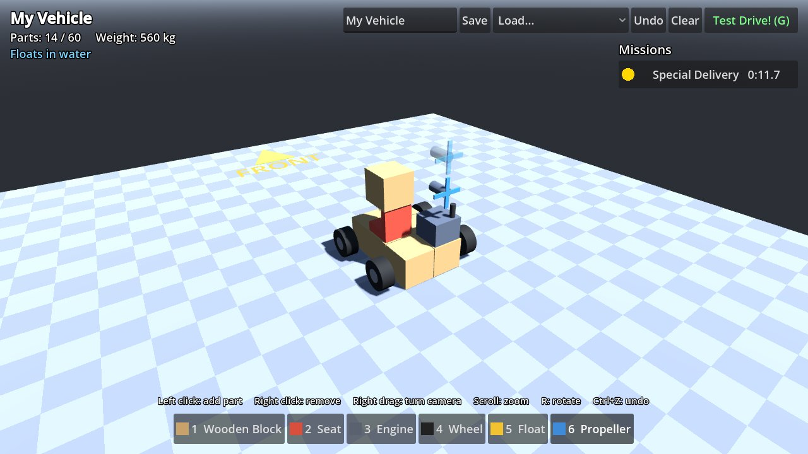
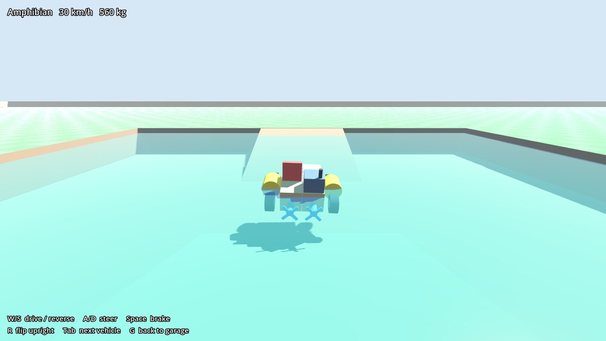
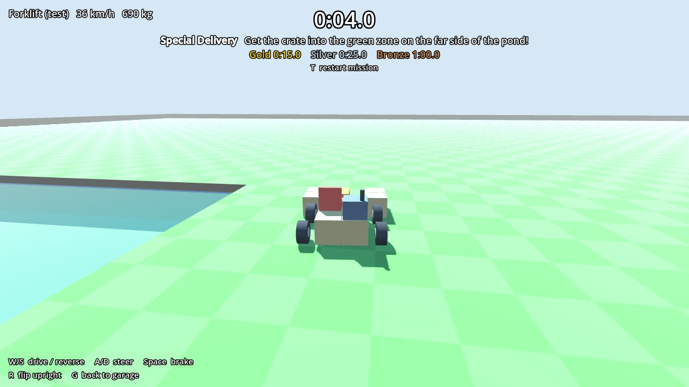
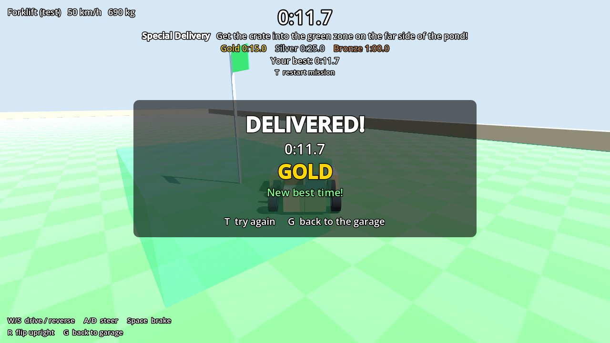

# Bodgeworks

A father–son hackathon project: a physics sandbox where you bolt parts together into vehicles, then use them to beat challenges. Players build from modular parts on a grid, the design compiles into physics, and challenges score the result. Rewards unlock new parts, and new parts open new ways to solve every challenge.

**How we work:** get a minimal playable version first, then iterate. The docs below are a starting point, not gospel. Change them when the game teaches us something.

| | |
|---|---|
|  |  |
| **The garage:** snap parts together like Lego | **Floats and propellers:** swim across the pond |
|  |  |
| **Special Delivery:** get the crate to the far side | **Beat the clock:** gold, silver or bronze |

*Screenshots are from Godot's basic Compatibility renderer, so the colours look flatter than they do on a normal graphics card.*

## Play it

New here? **[Getting started](docs/getting-started.md)** takes you from nothing installed to driving, step by step.

**What works so far:**
- A **garage** where you build vehicles from parts like Lego, then save them and test drive them.
- A first mission, **Special Delivery**, with gold, silver and bronze times.
- A test map with a jump ramp, a pond, crates and hills.
- Wheel suspension, floating, and propellers that steer in water (they push much harder in water than in air).
- New parts can be added by editing JSON.

**Next up:** see what the playtesters (one dad, one son) ask for.

## Docs

| Doc | What it is |
|---|---|
| [Getting started](docs/getting-started.md) | Install Godot, open the project, controls, and how to make your own vehicles and parts. |
| [Game mechanics reference](docs/spec/game-mechanics.md) | Analysis of the vehicle-construction genre: building, physics, challenges, progression, and the design pillars we're borrowing from. |
| [Architecture](docs/spec/architecture.md) | Proposed Godot 4 + Rust (gdext) + Jolt architecture, data flows, and the first vertical-slice milestone. |

## Design pillars (short version)

1. **Modularity:** reusable parts with defined properties.
2. **Physical simulation:** design choices have physical consequences.
3. **Player expression:** players build their own tools.
4. **Objective-based play:** the game sets the goal, and the player works out how to reach it.
5. **Iterative engineering:** failure feeds redesign.
6. **Expanding possibility space:** new parts enable new solutions.
