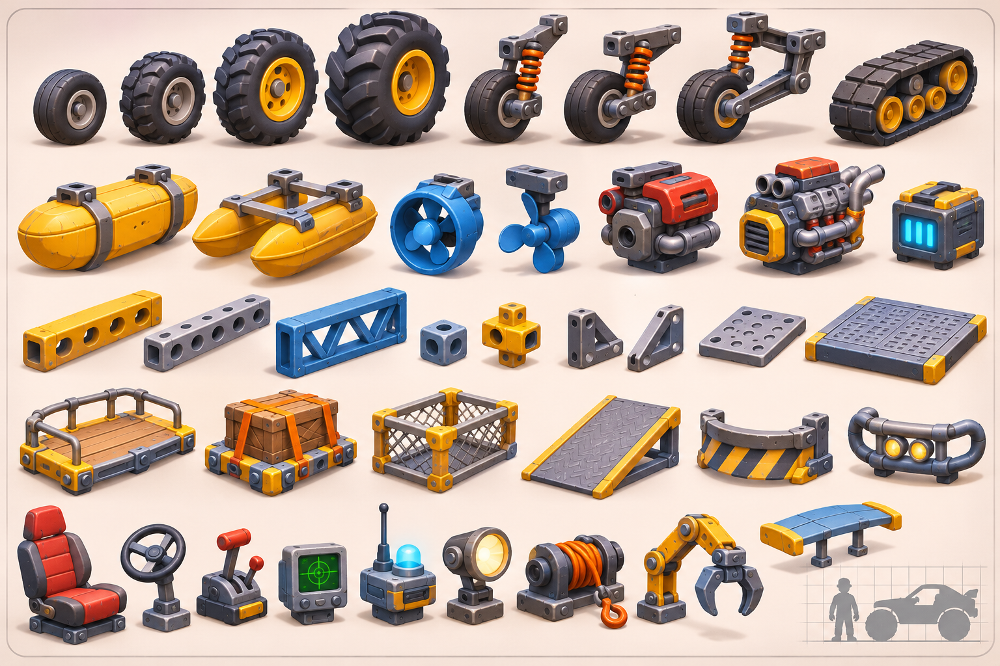
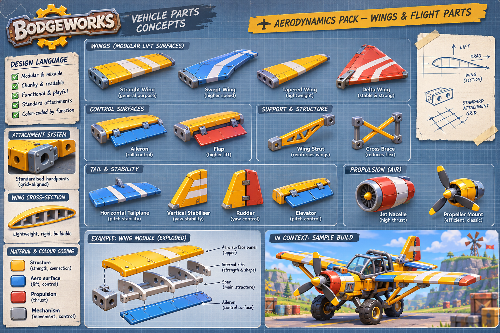
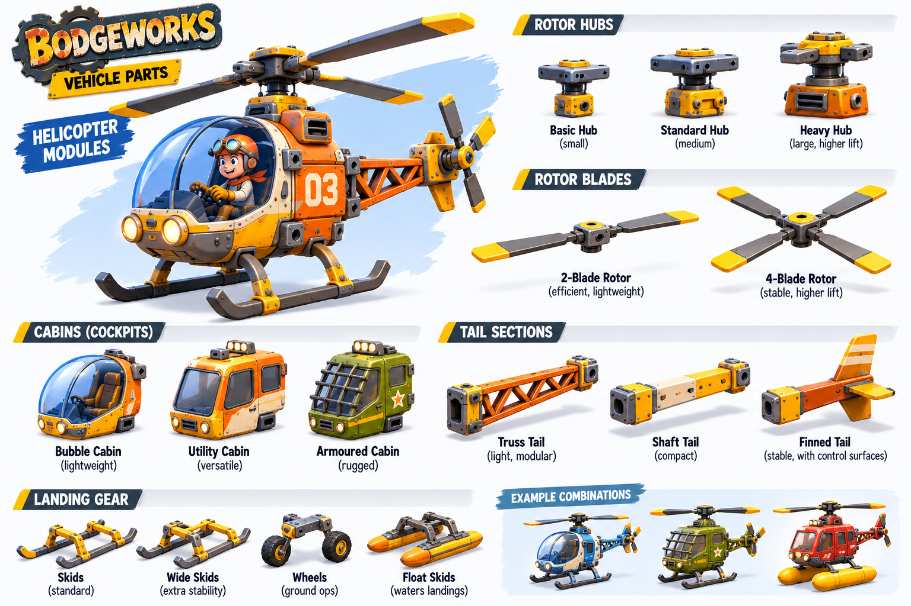
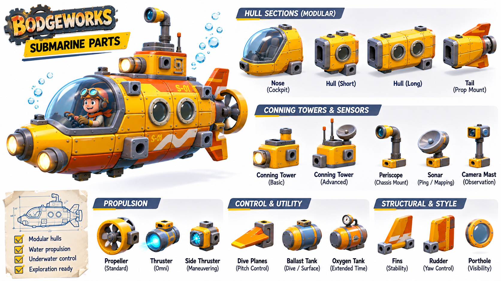
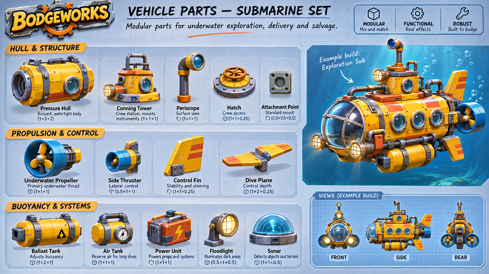
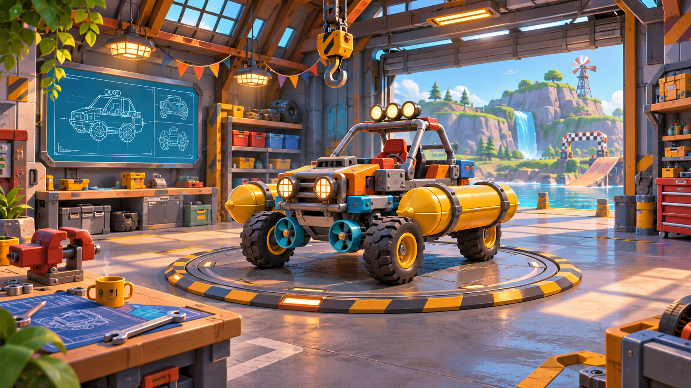
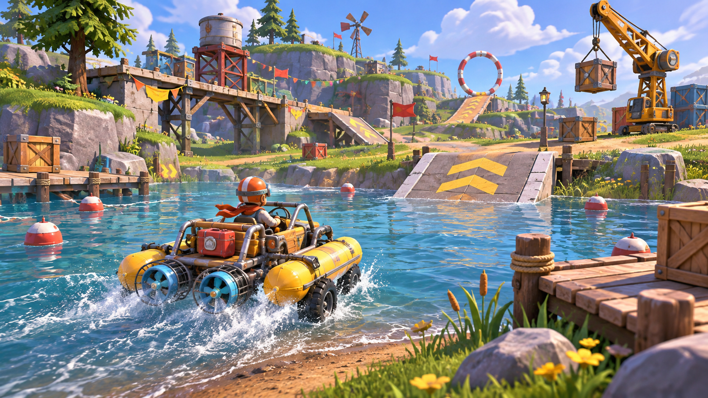

# Concept art

Mood boards and part ideas for Bodgeworks. They are inspiration, not specs: use them to choose part looks, colours and what to build next. Nothing here is a promise that a part exists in the game.

**Look and feel from these sheets:** chunky, readable, toy-like parts with bolted square attachment points on a grid. Bright and a bit worn. Colours code what a part does:

| Colour | Means |
|---|---|
| Yellow | Structure (holds things together) |
| Blue | Air or water surfaces (lift, control), propellers |
| Red | Propulsion (engines, thrust) |
| Grey | Mechanisms (hinges, mounts, moving parts) |

## Parts

| Sheet | What's on it |
|---|---|
| [Parts sheet](parts-sheet.webp) | Wheels, suspension, tracks, floats, propellers, engines, battery, beams, plates, cargo beds, ramp, bumper, seat, controls, lights, winch, claw, spoiler |
| [Wings and flight](wings-and-flight-parts.webp) | Wings (straight, swept, tapered, delta), ailerons, flaps, struts, tailplanes, rudder, elevator, jet and propeller mounts |
| [Helicopter parts](helicopter-parts.webp) | Rotor hubs, 2- and 4-blade rotors, cabins, tail booms, skids, wheels and floats |
| [Submarine parts](submarine-parts.png) | Hull sections, conning towers, periscope, sonar, thrusters, dive planes, ballast and oxygen tanks, fins, rudder |
| [Submarine set](submarine-set.png) | Pressure hull, hatch, side thrusters, ballast and air tanks, power unit, floodlight, sonar, with front, side and rear views |

## Places

| Image | What it shows |
|---|---|
| [Garage](garage.png) | The workshop where you build: turntable, blueprints on the wall, tools, and a door out to the world |
| [Pond world](world-pond.webp) | An amphibious buggy at the pond, with boat ramp, buoys, docks, a crane and a stunt ring |

