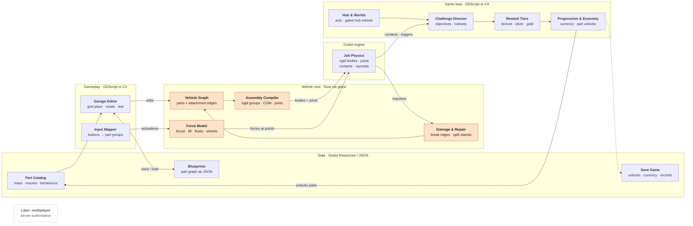

# Vehicle Construction Game — Godot 4 Architecture

**Core idea:** blueprints compile into physics, and gameplay is built around that core.

Players build vehicles from modular parts on a grid. A Rust core compiles each design into rigid bodies, joints and per-part forces. Jolt physics simulates them, and challenges score the result. Each tier of reward unlocks new parts, and those new parts open new ways to solve every challenge. That is the explore → build → test → reward loop from the mechanics analysis.

## Layers

### Data (Godot Resources / JSON)
- **Part Catalog:** one definition per part type: mass, size, attachment points, and a list of behaviours (thrust, lift, buoyancy, wheel, spring, storage, weapon, input binding). New parts should come from adding data, not from writing code.
- **Blueprints:** a saved vehicle stored as a graph: placed parts (type, grid position, rotation) plus the attachment edges between them. These are what players save, share and rebuild designs from.
- **Save Game:** unlocked parts, currency, best scores per challenge and other records.

### Gameplay (GDScript or C#)
- **Garage Editor:** a 3D grid editor for placing, rotating and removing parts. It edits the Vehicle Graph directly and includes a test-drive mode.
- **Input Mapper:** maps buttons to groups of parts. Several parts can share one button, as in the original game's accessory buttons.

### Vehicle core (Rust via godot-rust/gdext)
This is the risky, performance-critical part, and it can be tested on its own without the engine.
- **Vehicle Graph:** the single source of truth for a vehicle: the parts and the attachment edges that join them.
- **Assembly Compiler:** finds the rigidly connected groups of parts and makes each group one compound body with summed mass, centre of mass and inertia. Joints appear only where something actually moves (axles, hinges, springs, detachers). This avoids the long joint chains that make vehicles wobble and blow up.
- **Force Model:** runs every physics tick and applies each part's force at that part's mount point. Off-centre thrust therefore turns the vehicle, wings get lift and drag from airspeed and angle, floats get buoyancy from how deep they sit, and wheels use raycast suspension.
- **Damage & Repair:** collision impulses above a connection's strength delete that edge. If the graph splits, the vehicle is recompiled and the broken-off part falls away. Repair puts the edge back.

### Godot engine
- **Jolt Physics:** rigid bodies, joints, contacts and raycasts. It is reported to be built into Godot since 4.4; confirm against your target Godot version.

### Game loop (GDScript or C#)
- **Hub & Worlds:** a central hub leading to worlds split into acts. The hub uses a fixed, upgradeable vehicle so players can't fly past exploration gates early.
- **Challenge Director:** runs the objectives (racing, cargo, combat, sports, escort) under one of three rulesets: Player's Choice, Limited parts, or Designated vehicle. It reads contacts and trigger volumes from Jolt.
- **Reward Tiers:** bronze, silver and gold thresholds. A higher tier also awards every lower one, and challenges are repeatable so players optimise their designs.
- **Progression & Economy:** spends currency on parts and unlocks new parts, which loop back into the Part Catalog.

### Later: multiplayer
The server owns the physics. Clients send their inputs and blueprints, and the server sends back vehicle state. Plan for this from the start, but build it after the single-player loop works.

## Key data flows

| Flow | Meaning |
|---|---|
| Catalog → Garage | The editor offers only unlocked parts |
| Garage ↔ Blueprints | Save and load designs |
| Garage → Vehicle Graph | Every edit updates the live graph |
| Graph → Compiler → Jolt | Build compound bodies and joints |
| Input → Force Model → Jolt | Button presses become forces at mount points |
| Jolt → Damage → Graph | Collision impulses break edges, then the vehicle is recompiled |
| Jolt → Challenge Director | Checkpoints, deliveries, hits and goals |
| Progression → Catalog | Rewards unlock new parts |

## First milestone (vertical slice)
1. Write down the part-definition and blueprint formats.
2. In Rust, compile a hard-coded blueprint into Jolt bodies and drive it in a test map with land and water.
3. Build a garage editor with about 10 parts: block, seat, engine, fuel tank, wheel, propeller, wing, float, spring, tray.
4. Add one cargo-delivery challenge with three reward tiers.
5. Enforce a part budget from day one. It's a game rule and also your performance limit.
