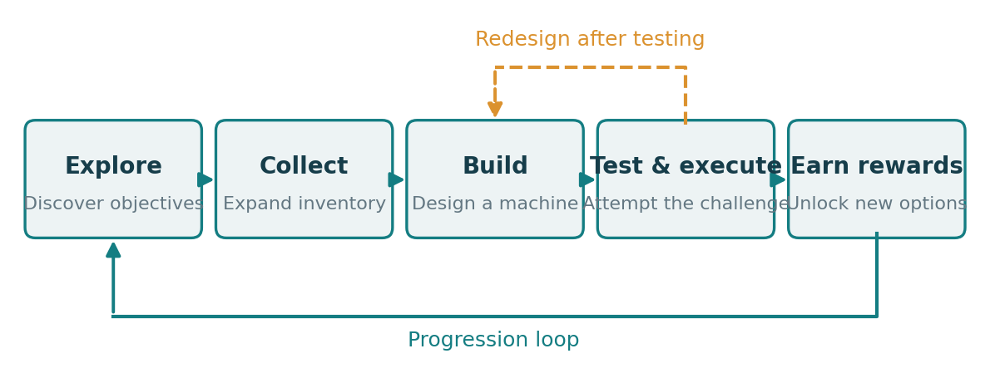
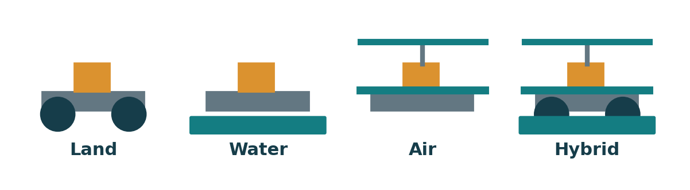
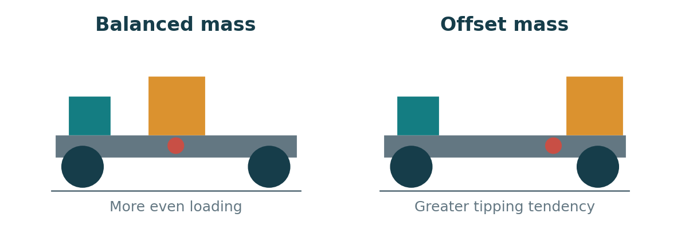
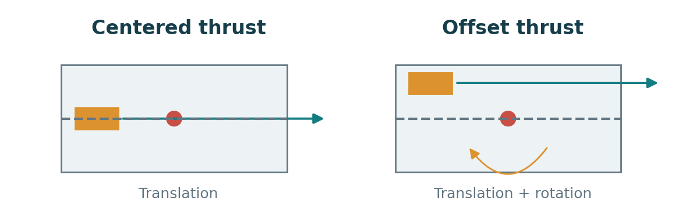
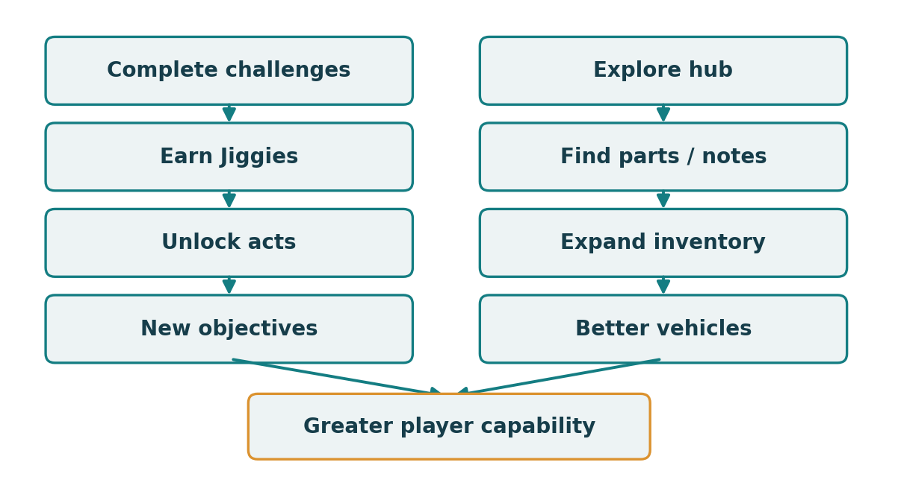
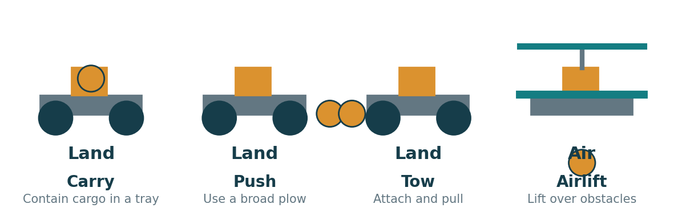

# Vehicle Construction & Physics-Based Gameplay

*Game mechanics / design reference: the mechanics analysis this project starts from. A starting point, not gospel.*

# 01 Overview

This document analyzes Banjo-Kazooie: Nuts & Bolts (Rare, 2008), a modular vehicle-construction sandbox embedded in a collectible-driven action-adventure. It focuses on transferable systems, not franchise-specific presentation.

## Core design thesis

The game defines the objective; the player invents the means of achieving it. Instead of receiving a fixed moveset, players assemble their own capabilities from functional parts. Engineering mastery and execution mastery reinforce one another.

*Figure 1.* The exploration, construction, testing and reward loop.

## Scope

Construction, physical simulation, controls, challenge design, world structure, progression, emergent solutions, multiplayer and design tradeoffs. All illustrations are original schematic reconstructions, not game screenshots or engine data.

# 02 Modular construction

The garage is a three-dimensional editor. Players place and rotate parts on a spatial grid, connect them at attachment points, and remove or rearrange them. Conventional vehicle classes are not required; the geometry and installed components define behavior.

| **Component**                  | **Function**                                        |
|--------------------------------|-----------------------------------------------------|
| Seats / body blocks / panels   | Control position, structural geometry and enclosure |
| Engines / fuel tanks           | Power and operating endurance                       |
| Wheels / propellers / jets     | Ground, water or airborne propulsion                |
| Wings / floats / balloons      | Aerodynamic lift, buoyancy or lighter-than-air lift |
| Springs / weapons / ammunition | Launching, combat and weapon resources              |
| Storage / passenger seats      | Transport physical cargo and characters             |
| Special gadgets / cosmetics    | Special functions and appearance                    |

*Figure 2.* Emergent vehicle archetypes; hybrid designs combine locomotion systems.

## Blueprints and testing

Save designs as blueprints, create variants, upgrade old builds or use premade designs. A dedicated test environment supports experimentation before committing to challenges. The game abstracts wiring, fuel lines and transmissions so the player can focus on component choice and arrangement.

# 03 Physical simulation

The game uses Havok-based physics with custom vehicle assembly and destruction systems. Components contribute mass, mass distribution, flotation and drag. The objective is accessible, exaggerated physical behavior rather than strict engineering realism.

*Figure 3.* Conceptual weight distribution; heavy components are amber and the red dot represents center of mass.

*Figure 4.* Conceptual thrust placement; an offset force can introduce rotation.

## Consequences of construction

Mass and momentum influence acceleration, braking and impacts. Traction affects grip; torque affects rotation; lift, buoyancy and gravity determine movement through air and water. Structural connections can fail during impacts or combat, causing functional damage. A lost wheel or wing changes behavior; the wrench can repair damaged vehicles.

# 04 Controls and resources

Conventional movement controls are separated from configurable accessories. On Xbox 360, the left stick steers, triggers control acceleration and braking/reversing, and the right stick controls the camera. A, X and B can activate accessories; Y enters or exits vehicles. Multiple components may share an activation button.

| **Specialized component**      | **Example function**                        |
|--------------------------------|---------------------------------------------|
| Sticky Ball / Tow Bar          | Attach to and pull objects                  |
| Spring / Folding Wing          | Launch or alter flight configuration        |
| Storage Tray / Liquid Squirter | Carry cargo or spray targets                |
| Detacher / Gyroscope           | Separate assemblies or assist stabilization |
| Spec-O-Spy / Self-Destruct     | Aiming assistance or deliberate destruction |

## Resource tradeoffs

| **Constraint**    | **Design consequence**                                             |
|-------------------|--------------------------------------------------------------------|
| Fuel / ammunition | Limits sustained operation and weapon use                          |
| Power / mass      | More power can improve performance but adds weight and consumption |
| Strength          | Protective structure may reduce agility                            |
| Part budget       | Limits maximum construction complexity                             |

The design challenge is not to maximize every attribute, but to select the right combination for the task. A lightweight racer and a heavy cargo carrier have different optimal configurations.

# 05 Challenge design

NPCs offer repeatable objectives. Players choose or build a vehicle, attempt the mission, and can return with an improved design. Objectives test both engineering and direct control.

| **Challenge family** | **Primary demands**                            |
|----------------------|------------------------------------------------|
| Racing               | Checkpoints, speed, traction and handling      |
| Cargo transport      | Capacity, retention and delivery efficiency    |
| Combat / defense     | Weapons, protection and physical impacts       |
| Physics-based sports | Launches, balls, goals and unusual scoring     |
| Navigation / escort  | Obstacle traversal, control and safe transport |

## Rulesets

Player’s Choice allows eligible custom vehicles; Limited restricts available components; designated-vehicle challenges prescribe a premade machine. These alternate open-ended design problems with controlled execution tests.

*Figure 5.* Illustrative reward tiers, not actual numerical thresholds.

Higher performance tiers also grant lower-tier rewards. Four T.T. Trophies can be exchanged for an additional Jiggy. Repeatability encourages optimization rather than one-time completion.

# 06 World structure

A central hub connects large challenge environments. The hub uses a designated, upgradeable trolley instead of unrestricted custom vehicles, preserving exploration gates and preventing early flight from bypassing puzzles.

| **Hub facility**          | **Purpose**                                  |
|---------------------------|----------------------------------------------|
| Garage / shop             | Build, test and buy components or blueprints |
| Reward dispensers / bank  | Collect and register progression rewards     |
| Factory                   | Unlock access to new environments            |
| Gym / hint kiosk          | Character upgrades and guidance              |
| Bingo / police facilities | Side activities and token rewards            |

## Environmental variety

| **Environment**      | **Traversal and gameplay character**            |
|----------------------|-------------------------------------------------|
| Farmland             | Open hills, waterways and industrial machinery  |
| Electronics interior | Vertical spaces, machinery and narrow platforms |
| Museum               | Landmarks and mixed traversal spaces            |
| Sports arena         | Races, stunts and physical competitions         |
| Alien terrarium      | Enclosed spaces and complex traversal           |
| Home region          | Final confrontation                             |

Major environments are divided into acts, reusing physical spaces while varying NPC locations, objectives and circumstances. This creates economical world production but can reduce the feeling of discovery.

# 07 Progression and economy

| **Resource**     | **Role**                                          |
|------------------|---------------------------------------------------|
| Jiggies          | Unlock worlds and acts; 131 in the base game      |
| Musical Notes    | Purchase components, blueprints and services      |
| Component crates | Expand construction inventory through exploration |
| T.T. Trophies    | High-performance rewards exchanged for Jiggies    |
| Jinjo Tokens     | Redeem side-activity rewards                      |
| Trolley upgrades | Unlock further hub traversal                      |
| Blueprints       | Preserve reusable machine designs                 |

*Figure 6.* Two complementary progression paths: mission access and construction capability.

Progression expands the player’s mechanical vocabulary. New components introduce new ways to solve both future and previously completed objectives, rather than merely raising numerical attributes.

# 08 Character and emergent systems

## On-foot interaction

The player can leave a vehicle to run, jump, swim, dive, climb or attack. A magical wrench replaces many traditional moves, enabling object manipulation, cargo loading, switches, attacks and repairs. Character and machine remain separate entities, allowing combined traversal and manipulation puzzles.

## Multiple solutions to a single goal

*Figure 7.* Four conceptual ways to move cargo to a destination.

Transporting an object can be approached by carrying it in a tray, pushing it, towing it or lifting it over terrain. The same objective can support several physical strategies without scripting each as a separate gameplay system. Flying over obstacles, oversized collection trays, momentum-based attacks and lightweight builds are other examples of emergent problem-solving.

## Multiplayer and social play

The original release supported competitive matches for up to eight players, team and free-for-all modes, local two-player cooperative play against computer opponents, custom vehicle competitions, blueprint sharing, leaderboards, replays and photography. This describes the launch feature set; current online service availability is not verified.

# 09 Design implications

| **Strength**                          | **Player impact**                               |
|---------------------------------------|-------------------------------------------------|
| Modularity and consistent physics     | Creative freedom with tangible consequences     |
| Multiple solutions and repeatability  | Experimentation, optimization and replayability |
| Component progression                 | Gradual expansion of complexity                 |
| Blueprints and accessible engineering | Reduced rebuilding and technical overhead       |

## Tradeoffs

| **Weakness**                            | **Potential effect**                        |
|-----------------------------------------|---------------------------------------------|
| Repetitive objectives / reused spaces   | Monotony and reduced discovery              |
| Awkward handling / physical instability | Frustration and inconsistent results        |
| Editor overhead                         | Interrupts action with construction         |
| Overpowered builds                      | May trivialize intended challenges          |
| Prescribed vehicles                     | Temporarily limits creative agency          |
| Genre shift                             | May disappoint traditional platforming fans |

## Related design patterns

Trailmakers emphasizes modular vehicles; Besiege emphasizes physical objective-solving; Scrap Mechanic and Main Assembly emphasize construction; TerraTech and Crossout combine modularity with combat or progression. Kerbal Space Program emphasizes engineering iteration, while Tears of the Kingdom and Bad Piggies illustrate emergent assembled-device solutions.

# 10 Design pillars & research notes

| **Pillar**                     | **Design principle**                            |
|--------------------------------|-------------------------------------------------|
| 01 Modularity                  | Reusable components with defined properties     |
| 02 Physical simulation         | Design choices produce physical consequences    |
| 03 Player expression           | Players create their own tools and capabilities |
| 04 Objective-based play        | Specify outcomes rather than solutions          |
| 05 Iterative engineering       | Failure supports redesign and experimentation   |
| 06 Expanding possibility space | New parts enable increasingly complex solutions |

## Conclusion

Construction supplies possibilities, simulation supplies consequences, objectives supply purpose, and progression supplies new possibilities. The distinctive innovation is making the creation of gameplay abilities itself a gameplay mechanic.

## Research basis

The preceding analysis draws on the original Xbox 360 instruction manual, Rare’s physics developer diary, developer interviews with Gregg Mayles, contemporary reviews and walkthroughs, and community-maintained component catalogs. The diagrams are conceptual, not extracted from source code. Exact physics coefficients and comprehensive component specifications are outside the scope of this document.

Reference locator: original manual (Xbox 360, 2008); Rare developer physics diary (2008); GameSpot walkthrough (2008); Rare Revealed development retrospective (YouTube). Source links from the earlier chat were not reproduced because their exact addresses were not available in the document-generation context.
